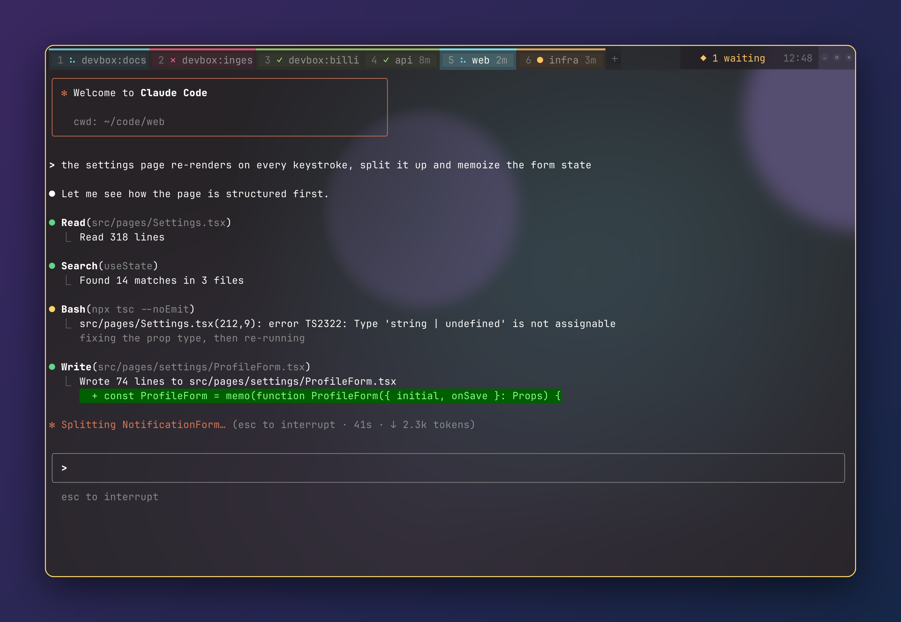
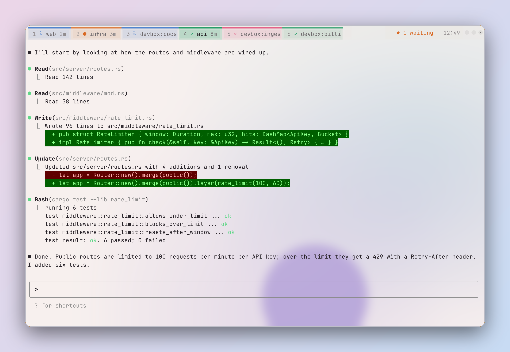

# pult-term

A terminal for running many [Claude Code](https://claude.com/claude-code) sessions at once, and seeing at a glance which
ones are working, which wait for you and which are done.

pult-term is a fork of [WezTerm](https://wezterm.org) by Wez Furlong. Everything WezTerm does, it does too; the additions
below are small and kept apart, so that upstream can be merged. It is the terminal half of
[pult](https://github.com/kisAsztal/pult), which provides the persistent sessions and the status; without pult it works as an
ordinary WezTerm.


Every tab is a persistent session, coloured by what its Claude is doing: working, waiting for permission, done, failed. A
session that needs you pulses, and the window frame turns yellow while anything waits.

| | |
|---|---|
|  |  |
| A working session, with its spinner | `F2`: every session on every machine, those waiting for you first |

The light theme follows the system setting:



## Everything is on `F1`

You do not have to learn any keys. `F1` opens a searchable list of everything you need: sessions on every machine, jump to
the tab that waits for you, Claude in this tab, a new session on any host, close or stop a tab, full screen, search, paste.
Type to filter, `Enter` runs the entry. (The bindings come with the [pult](https://github.com/kisAsztal/pult) config.)

## What it adds to WezTerm

- **A status stripe on every tab**, drawn from the tab title, so the state of each session reads from across the room.
- **Native tab animation**: a spinner on working tabs, a pulse on tabs that wait for you, and smooth colour fades between
  states, all without Lua timers.
- **Floating pickers**: the `InputSelector` is a panel under the tab bar instead of an overlay that covers the whole tab.
- **Notifications with buttons** from Lua (Linux), and raising the window on click (Wayland xdg-activation).
- **No update check against upstream**: it is off by default, since the WezTerm releases are not ours.

Details, the Lua API and how it is wired in: [PULT-TERM.md](PULT-TERM.md).

## Install

Linux (GNOME is the most used desktop for it), from source:

```sh
git clone https://github.com/kisAsztal/pult-term
cd pult-term
pult/install.sh                         # build with cargo, install for the current user
pult/install.sh --set-default --dock    # optional: default terminal, dock favourite (see --help)
```

You need Rust and WezTerm's build dependencies (`./get-deps`). To get the tab colours, persistent sessions and the pickers,
also install [pult](https://github.com/kisAsztal/pult); its installer links the WezTerm config that pult-term uses.

macOS and Windows are not built or tested by this fork.

## Relationship to WezTerm

- The fork follows upstream `main` (`git fetch upstream && git merge upstream/main`). Everything not listed above is
  stock WezTerm, and its [documentation](https://wezterm.org) applies: configuration, fonts, key bindings, multiplexing.
- Report problems with the additions above here. Problems with WezTerm itself belong
  [upstream](https://github.com/wezterm/wezterm/issues), after checking that they do not come from the changes in this fork.
- License: MIT, as WezTerm. Copyright of the original: Wez Furlong; of the changes: kisAsztal. See [LICENSE.md](LICENSE.md).
